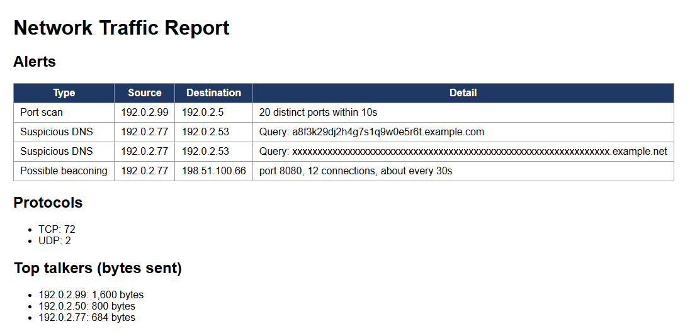
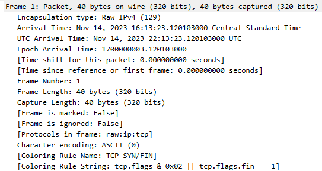

# Network Traffic Analyzer

A Python network traffic analysis and security triage tool built with **Scapy** to parse `.pcap` packet captures, detect suspicious activity (TCP SYN scans, anomalous DNS lookups, and periodic beaconing), score risk findings, and generate HTML summary reports.

## Key Capabilities

- **PCAP Parsing (`analyzer/`):** Reads `.pcap` files using Scapy and extracts timestamps, source and destination IP addresses, protocols, source/destination ports, TCP flags, and DNS query details.
- **Threat & Anomaly Detection:**
  - **SYN Scan Detection:** Identifies connection attempts (`SYN=1, ACK=0`) targeting multiple ports or hosts within a short time window.
  - **DNS Lookup Analysis:** Highlights unusual, excessive, or suspicious domain name queries.
  - **Beaconing Detection:** Evaluates repeated connections to the same destination for regular timing intervals (low jitter) characteristic of automated callbacks.
- **Scoring & HTML Reporting:** Aggregates detections into severity/risk summaries and writes HTML reports to `reports/`, with a reference copy stored in `docs/sample_report.html`.

## Visual Proof

### HTML Triage Report


### Wireshark Packet Inspection


## Repository Structure

```text
network-traffic-analyzer/
├── analyzer/
│   ├── __init__.py
│   ├── summary.py
│   ├── detections.py
│   └── report.py
├── docs/
├── pcaps/
│   └── test.pcap
├── reports/
├── main.py
├── make_test_pcap.py
├── requirements.txt
├── .gitignore
└── README.md